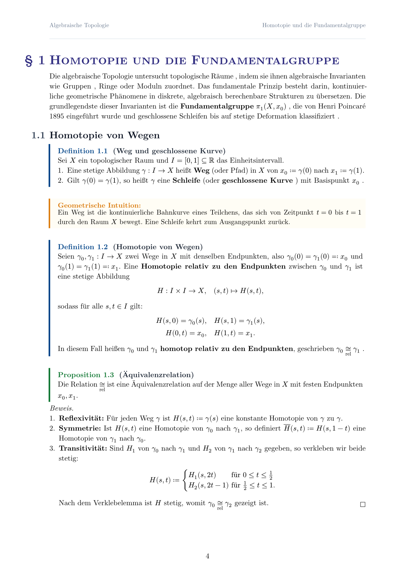
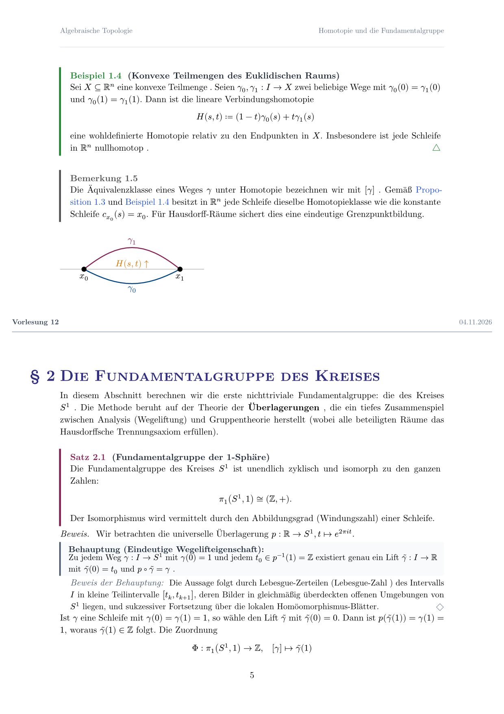
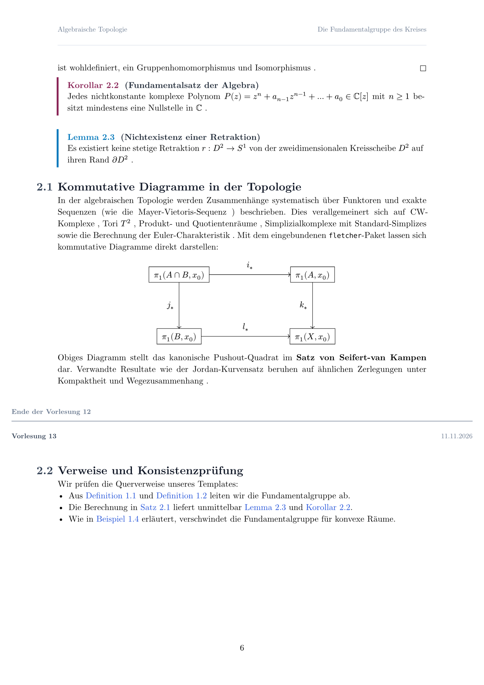
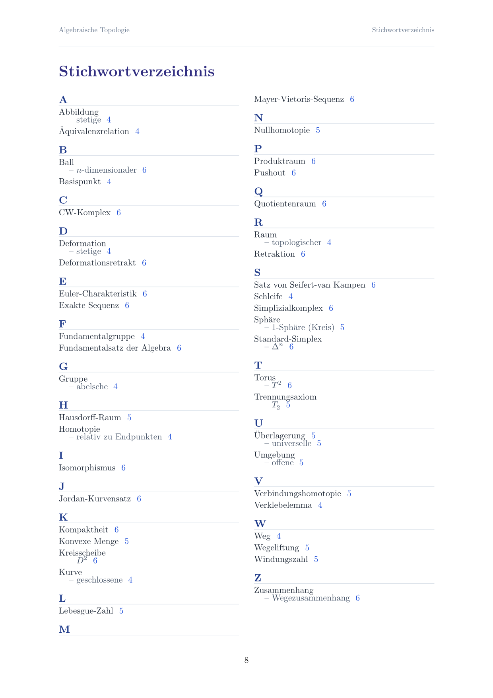
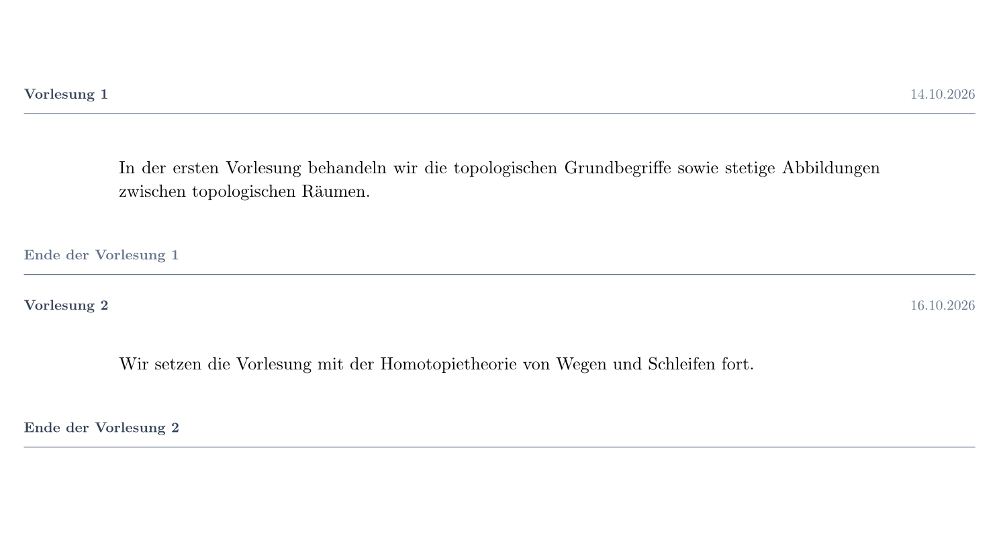

# Typst Script Template

A clean, modern, and extensible Typst template designed for comprehensive lecture notes, scripts, and textbooks in mathematics and the natural sciences.

## Visual Showcase

| Mathematical Environments & Intuition | Lecture Markers, Theorems & Subproofs |
| :---: | :---: |
|  |  |

| Fletcher Diagrams & Cross-References | Two-Column Subject Index (Stichwortverzeichnis) |
| :---: | :---: |
|  |  |

---

## Key Features

- **Unified Mathematical Environments:** Coherent, unified numbering counter across all environments (`#definition`, `#theorem`, `#lemma`, `#proposition`, `#corollary`, `#example`, `#remark`, `#construction`) matching cross-references (`@label` shows e.g. `Definition 1.1`).
- **Geometric Intuition Blocks:** Dedicated `#intuition[...]` blocks with warm amber styling, ideal for visual concepts in topology and geometry.
- **Structured Proofs & Subclaims:** Formal proofs (`#proof[...]`) with end-of-proof Halmos square (`$square$`), plus nested claims (`#claim[...]`) and indented subproofs (`#subproof[...]`).
- **Outdented Lecture Markers:** Clean horizontal dividers marking lecture starts (`#lecture(...)`), breaks (`#lecture-break(...)`), and endings (`#lecture-end(...)`) with automatic `datetime` formatting.
- **Hanging Section Numbers:** Optional margin outdenting for section numbers (`§ 1`, `1.1`), aligning heading text perfectly with the paragraph margin.
- **Dynamic Notation Index:** Automatically registers mathematical symbols throughout the document via `#notate(symbol, desc)` and compiles a linked reference table (`#notation-index()`).
- **Alphabetical Subject Index:** Multi-column Stichwortverzeichnis (`#idx("Begriff")`, `#idx("Begriff", sub: "Unterbegriff")`, or content arguments like `#idx([Trennungsaxiom], [$T_2$])`) grouped by initial letter with clickable page links (`#subject-index()`).
- **Diagram Integration:** Pre-imports [Fletcher](https://typst.app/universe/package/fletcher) and [CeTZ](https://typst.app/universe/package/cetz) for commutative diagrams and geometrical sketches.

---

## Quick Start

```typst
#import "@local/script-template:0.1.0": *

#show: script-doc.with(
  title: "Algebraische Topologie",
  subtitle: "Vorlesungsskript",
  author: "Author Name",
  lecturer: "Prof. Dr. N. N.",
  semester: "Wintersemester 2026/27",
  university: "Musteruniversität",
  section-symbol: true,
  hanging-numbers: true,
  prologue: [
    Dieses Skript entstand begleitend zur Vorlesung ...
  ],
)

#table-of-contents(depth: 2)
#pagebreak()

#lecture(1, date: datetime(year: 2026, month: 10, day: 14))

= Mengentheoretische Topologie

== Topologische Räume

#definition(title: "Topologischer Raum")[
  Ein topologischer Raum ist ein Paar $(X, cal(T))$ ... #idx([Trennungsaxiom], [$T_2$])
] <def:top-space>

#theorem(title: "Hauptsatz")[
  Sei $X$ kompakt und $Y$ Hausdorffsch ...
] <thm:main>

#proof[
  Der Beweis folgt direkt aus @def:top-space.
]

#pagebreak()
#notation-index()

#pagebreak()
#subject-index()
```

---

## Available Environments

| Function | Kind | Accent Color |
| :--- | :--- | :--- |
| `#definition(title: "...")[...]` | Definition | Tol Navy (`#004488`) |
| `#theorem(title: "...")[...]` | Satz | Tol Bordeaux (`#882255`) |
| `#lemma(title: "...")[...]` | Lemma | Tol Blue (`#0077BB`) |
| `#proposition(title: "...")[...]` | Proposition | Tol Forest Green (`#117733`) |
| `#corollary(title: "...")[...]` | Korollar | Tol Wine (`#882255`) |
| `#example(title: "...")[...]` | Beispiel | Tol Green (`#228833`) |
| `#remark(title: "...")[...]` | Bemerkung | Slate Gray (`#555555`) |
| `#construction(title: "...")[...]`| Konstruktion | Warm Brown (`#78350f`) |
| `#intuition[...]` | Geometrische Anschauung | Warm Ochre (`#d97706`) |
| `#proof[...]` | Beweis mit $square$ | Standard italic with Halmos |
| `#claim[...]` / `#subproof[...]` | Behauptung & Teilbeweis | Slate card with $diamond.stroked$ |

---

## Lecture Markers

Lecture markers outdent horizontally across the page margins, cleanly separating lecture units with optional automatic `datetime` formatting.



```typst
// Single lecture start with automatic date formatting
#lecture(1, date: datetime(year: 2026, month: 10, day: 14))

// Transition between lectures
#lecture-break(1, 2, date: datetime(year: 2026, month: 10, day: 16))

// Standalone lecture end
#lecture-end(2)
```

---

## License

MIT License. See [LICENSE](LICENSE) for details.
